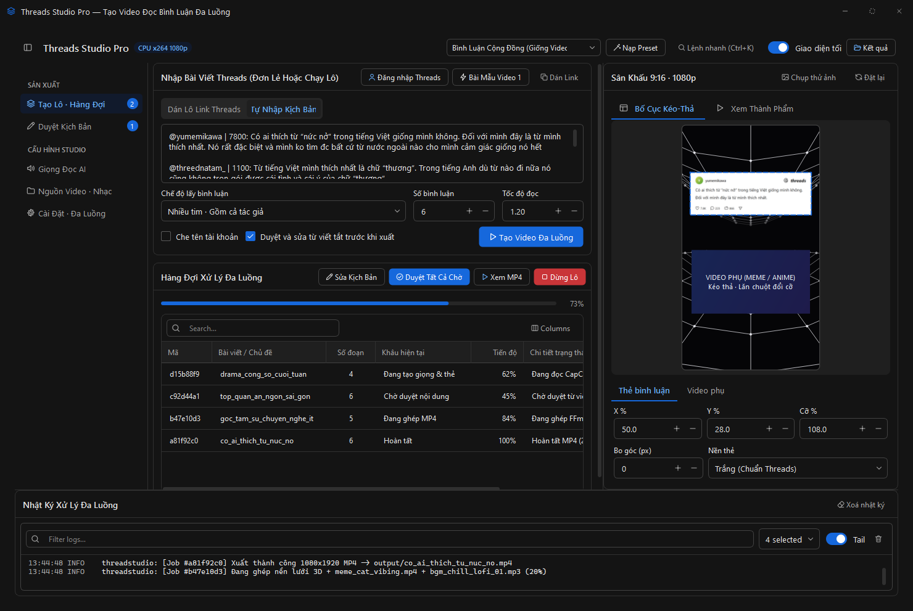
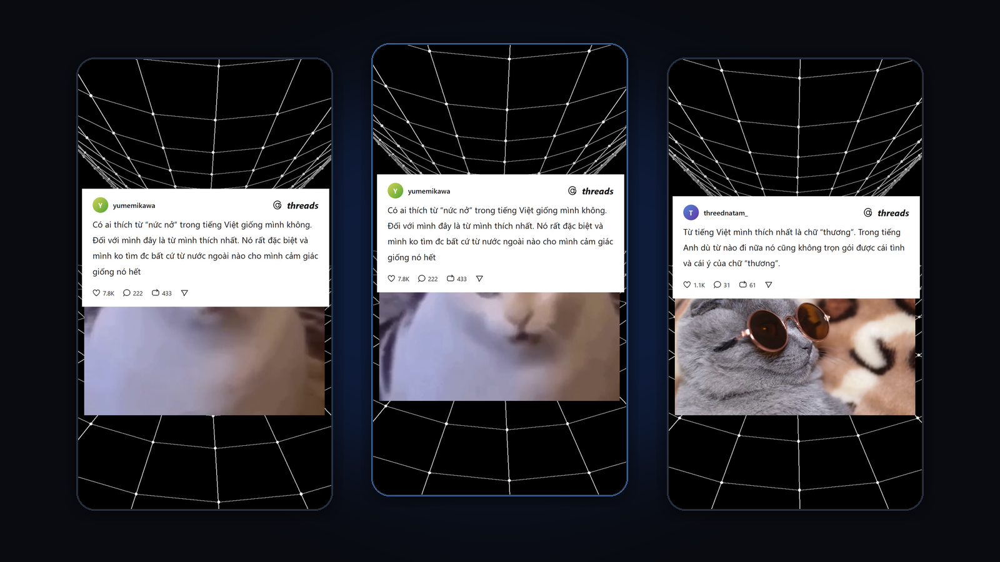
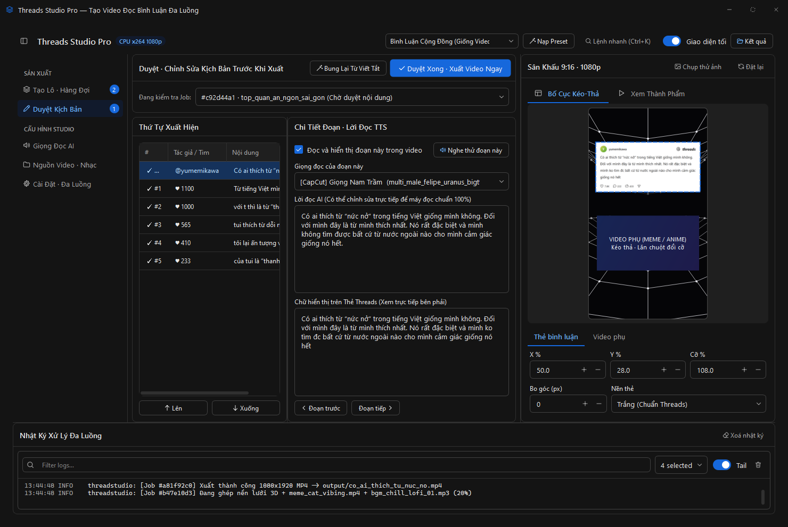
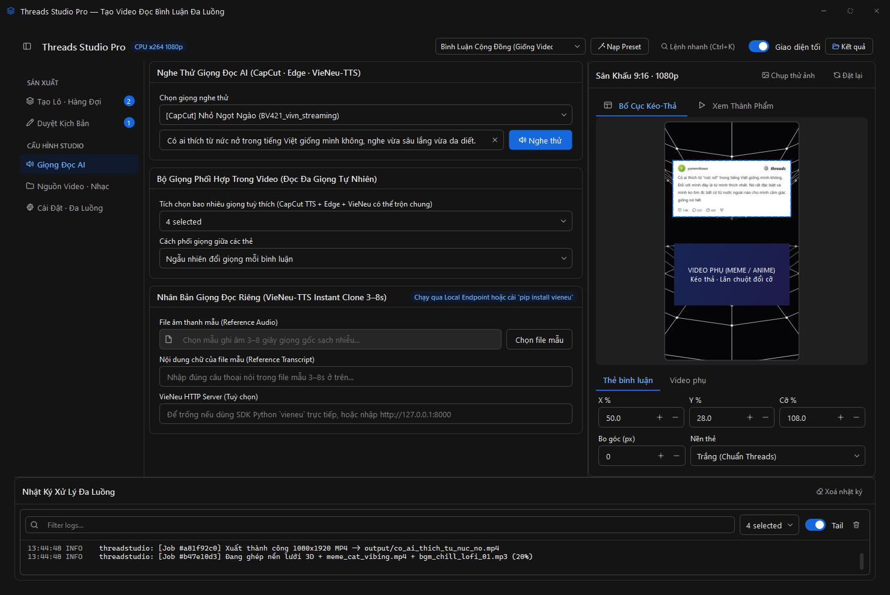
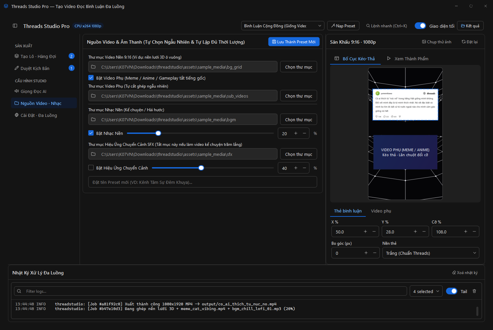
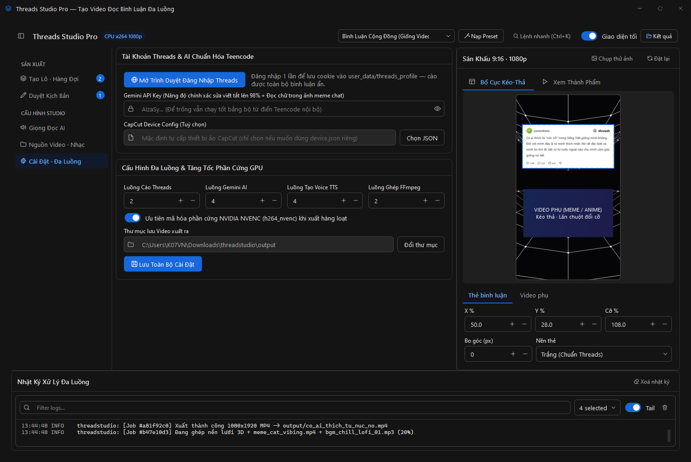
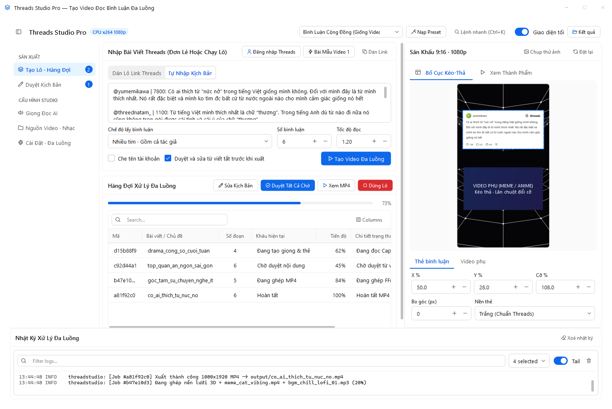
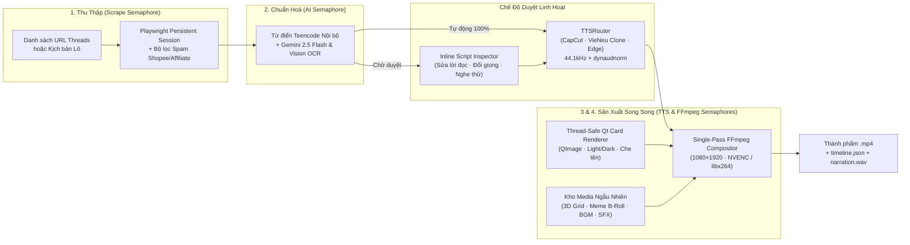

<div align="center">

# 🧵 Threads Studio Pro

**Multi-Threaded Desktop Video Production Studio for Threads Discussions & Storytelling (`1080×1920` Shorts / Reels / TikTok)**

[](https://www.python.org/)
[-2563EB?style=for-the-badge)](https://github.com/danieldev23/fluent-blue)
[](https://github.com/K07VN/capcut-tts-api)
[](https://ffmpeg.org/)
[](./LICENSE)

<p align="center">
  <a href="https://tnkre.dev"><b>🌐 TNKRE.DEV</b></a> •
  <a href="https://decompile.tnkre.dev"><b>🔬 DECOMPILE.TNKRE.DEV</b></a> •
  <a href="https://github.com/K07VN/capcut-tts-api"><b>🎙️ CapCut TTS API</b></a> •
  <a href="#-cài-đặt--khởi-chạy-nhanh"><b>⚡ Quick Start</b></a> •
  <a href="#-kiến-trúc-đa-luồng-stage-pipelined-architecture"><b>🏗️ Architecture</b></a>
</p>



</div>

---

## ✨ Giới thiệu (Overview)

**Threads Studio Pro** là phần mềm Desktop hiệu năng cao giúp tự động hóa hoàn toàn quy trình biến **hàng chục đường link bài viết Threads** (hoặc kịch bản nhập tay) thành video dọc **`9:16` (`1080×1920`)** sắc nét cho TikTok, Facebook Reels và YouTube Shorts.

Khác với các script ghép video đơn luồng hoặc giao diện dùng hộp thoại chặn màn hình, **Threads Studio Pro** được thiết kế như một bàn dựng phim chuyên nghiệp (**Operate Studio**):
- **Xử lý lô đa luồng theo tầng (Stage-Pipelined Concurrency)**: Cào bài viết, AI bung từ viết tắt, tổng hợp đa giọng đọc AI và xuất MP4 bằng GPU `h264_nvenc` chạy song song độc lập.
- **Sân khấu `9:16` Kéo-Thả Trực Quan (`WYSIWYG`)**: Kéo chuột đổi vị trí thẻ bình luận Threads & khung video phụ (Meme / Anime / Gameplay), lăn chuột phóng to thu nhỏ trực tiếp theo thời gian thực.
- **Đa nguồn Giọng Đọc AI & Nhân Bản Giọng (Instant Voice Cloning)**: Kết hợp mượt mà **22 giọng tiếng Việt tự nhiên của CapCut**, **VieNeu-TTS Offline (Clone giọng riêng chỉ từ 3–8 giây mẫu âm thanh)** và **Microsoft Edge Neural TTS**.

<p align="center">
  
</p>

---

## 🧩 Hệ sinh thái & Công nghệ Cốt lõi (Powered By)

Dự án được xây dựng trên nền tảng các thư viện mã nguồn mở hiện đại và hệ sinh thái nghiên cứu từ **[TNKRE.DEV](https://tnkre.dev)**:

| Tầng công nghệ | Dự án / Module tích hợp | Vai trò trong Threads Studio Pro |
|---|---|---|
| **Reverse Engineering & Ecosystem** | [**tnkre.dev**](https://tnkre.dev) · [**decompile.tnkre.dev**](https://decompile.tnkre.dev) | Nền tảng phân tích dịch ngược chuyên sâu, kiểm định kiến trúc nhị phân & giao thức API hiệu năng cao. |
| **Desktop Design System (PyQt6)** | [**danieldev23/fluent-blue**](https://github.com/danieldev23/fluent-blue) (`fluent-blue-studio`) | Hệ thống UI hướng token (`FluentWindow`, `DataTable`, `CommandPalette`, `LogViewer`, `VideoPlayer`, `ThemedMixin`) chuyển đổi nóng Dark / Light 0ms không dùng stylesheet cứng. |
| **UI Craft & Operate Architecture** | [**pbakaus/impeccable**](https://github.com/pbakaus/impeccable) | Tiêu chuẩn thiết kế giao diện mật độ cao (**Operate Mode**), phân cấp thị giác rõ ràng và kiểm chứng không gian hiển thị. |
| **Code-Graph & Agent Memory** | [**trailhq/Trail-Code**](https://github.com/trailhq/Trail-Code) | Lập chỉ mục đồ thị mã nguồn (`.trail/`) và lưu trữ tri thức kỹ thuật xuyên suốt vòng đời phát triển. |
| **CapCut Neural TTS Engine** | [**K07VN/capcut-tts-api**](https://github.com/K07VN/capcut-tts-api) | Cung cấp **22 giọng đọc tiếng Việt cảm xúc cao** (*Nhỏ Ngọt Ngào*, *Thanh Niên Tự Tin*, *Cô Gái Hoạt Ngôn*, *Giọng Nam Trầm*, *Alex Đại Đế*...) chạy trực tiếp không cần cấu hình phức tạp. |
| **Local AI TTS & Voice Cloning** | [**pnnbao97/VieNeu-TTS**](https://github.com/pnnbao97/VieNeu-TTS) | Tổng hợp tiếng Việt Offline chất lượng cao & **Nhân bản giọng đọc cá nhân (Instant Clone)** từ file mẫu 3–8 giây. |
| **Cloud Neural TTS Fallback** | [**rany2/edge-tts**](https://github.com/rany2/edge-tts) | Giọng đọc dự phòng tốc độ cao của Microsoft Azure (*Hoài Mỹ*, *Nam Minh*). |
| **Browser Automation & AI OCR** | [**microsoft/playwright-python**](https://github.com/microsoft/playwright-python) + **Gemini 2.5 Flash** | Lưu phiên đăng nhập Threads bền vững, bóc tách JSON SSR/GraphQL, lọc bình luận rác Affiliate và đọc chữ trong ảnh chụp màn hình/meme. |

---

## 🖥️ Giao diện Chi tiết (Studio Tour)

### 1. Duyệt Kịch Bản & Bung Từ Viết Tắt Trực Tiếp (Inline Script Inspector)
Tự động chuyển đổi teencode tiếng Việt (`ko` → `không`, `đc` → `được`, `mn` → `mọi người`, `đb` → `đặc biệt`...) sang câu đọc trôi chảy trong khi **vẫn giữ nguyên chữ gốc tự nhiên trên thẻ hình Threads**. Hỗ trợ sửa lời đọc từng câu, nghe thử giọng ngay lập tức, bật/tắt hoặc đổi thứ tự xuất hiện của từng bình luận mà không làm gián đoạn các luồng render khác.



### 2. Phòng Thu Giọng Đọc AI Đa Nguồn & Nhân Bản Giọng 3–8s
Cho phép tích chọn cùng lúc **nhiều giọng Nam/Nữ từ CapCut + VieNeu + Edge** để phần mềm tự động đổi giọng ngẫu nhiên (hoặc xoay vòng) cho từng bình luận — tạo cảm giác cuộc thảo luận cộng đồng sống động thật sự.



### 3. Kho Nguồn Video/Nhạc Tự Động & Bộ Cấu Hình Kênh (Channel Presets)
Tự động chọn ngẫu nhiên video nền `9:16`, cắt nối các clip Meme / Mèo / Anime / Gameplay tắt tiếng gốc, trộn nhạc nền Lofi (`20%`) và chèn hiệu ứng âm thanh chuyển cảnh (`Vine Boom`, `Pop`, `Whoosh` ở `40%`) khớp chính xác từng mili-giây chuyển thẻ. Đi kèm 3 Preset dựng sẵn và cho phép lưu Preset riêng cho từng kênh.



### 4. Điều Phối Đa Luồng, Cookie Threads & Tăng Tốc Phần Cứng NVIDIA NVENC
Tuỳ chỉnh độc lập số luồng **Cào Threads**, **Gemini AI**, **Tạo Voice TTS**, **Ghép FFmpeg** theo cấu hình máy và tự động kích hoạt bộ mã hoá phần cứng `h264_nvenc` trên card đồ họa NVIDIA.



### 5. Chuyển Đổi Giao Diện Sáng / Tối Tức Thì (Runtime Light & Dark Mode)
Nhờ kiến trúc token của [`fluent-blue`](https://github.com/danieldev23/fluent-blue), toàn bộ bảng dữ liệu, thanh cuộn và sân khấu `9:16` đổi sang chế độ Sáng (Light Mode) tức thì chỉ với 1 công tắc hoặc phím tắt `Ctrl+K`.



---

## 🏗️ Kiến trúc Đa Luồng (Stage-Pipelined Architecture)



---

## ⚡ Cài đặt & Khởi chạy nhanh

### Yêu cầu hệ thống
- **Python** `3.10` trở lên (khuyến nghị `3.11+`)
- **FFmpeg** & **FFprobe** đã có sẵn trong biến môi trường `PATH` (`winget install Gyan.FFmpeg` trên Windows)

### 1. Clone dự án & Cài đặt thư viện

```powershell
git clone https://github.com/K07VN/threadstudio.git
cd threadstudio

# Cài đặt CapCut TTS API & toàn bộ gói phụ thuộc của Threads Studio Pro
pip install git+https://github.com/K07VN/capcut-tts-api.git
pip install -e .
```

### 2. (Tuỳ chọn) Mở khoá Cào Link Threads & VieNeu Voice Cloning

```powershell
# Cài đặt nhân trình duyệt Chromium để đăng nhập & cào trực tiếp URL Threads
playwright install chromium

# Cài đặt VieNeu-TTS nếu muốn đọc Offline & Nhân bản giọng đọc riêng (3–8s audio)
pip install vieneu
```

### 3. Khởi chạy Studio

```powershell
python run_studio.py
```
*(Ngay lần chạy đầu tiên, nếu thư mục `assets/sample_media/` chưa có dữ liệu, ứng dụng sẽ tự động sinh sẵn video nền lưới 3D chuyển động, B-roll mẫu, nhạc nền và hiệu ứng chuyển cảnh để bạn bấm **`Bài Mẫu Video 1`** → **`Tạo Video Đa Luồng`** trải nghiệm ngay lập tức).*

---

## 🎛️ 3 Bộ Cấu Hình Kênh Có Sẵn (Built-in Presets)

| Preset | Mục đích sử dụng | Cấu hình tự động khi nạp |
|---|---|---|
| **Bình Luận Cộng Đồng (Giống Video Mẫu 1)** | Video hỏi đáp cộng đồng nhiều góc nhìn | Bài gốc + **6 bình luận nhiều tim**, trộn ngẫu nhiên **4 giọng Nam/Nữ CapCut** (`1.20×`), thẻ Trắng chuẩn Threads, BGM `20%`, tắt SFX. |
| **Kể Chuyện Dài Tác Giả (Storytelling)** | Chuỗi bài tâm sự / bóc phốt nhiều phần của cùng tác giả | Chế độ **`Chỉ tác giả`** (tới 10 đoạn nối tiếp), khoá **1 giọng Nam Trầm duy nhất** (`1.15×`), thẻ **Nền Tối (Dark)** bo góc `12px`, BGM `18%`. |
| **Bình Luận Hài Meme (Có SFX Chuyển Cảnh)** | Bài hài hước tập trung vào bình luận mặn của cư dân mạng | **8 bình luận nhiều tim (bỏ qua bài gốc)**, giọng hoạt ngôn tốc độ `1.25×`, **bật SFX chuyển thẻ (`40%`)** chèn *Vine Boom / Pop / Whoosh* kèm Meme B-roll. |

---

## 📂 Cấu trúc Thư mục Dự án

```text
threadstudio/
├── run_studio.py                         # Entrypoint khởi chạy nhanh ứng dụng Desktop
├── pyproject.toml                        # Khai báo package & dependencies chuẩn PEP 621
├── PRODUCT.md / DESIGN.md                # Đặc tả sản phẩm & ngôn ngữ thiết kế Operate UI
├── docs/assets/                          # Ảnh chụp giao diện thực tế & banner showcase
├── assets/sample_media/                  # Kho tài nguyên mẫu (bg_grid, sub_videos, bgm, sfx)
├── src/threadstudio/
│   ├── app.py                            # Khởi tạo QApplication, ThemeManager & FluentWindow
│   ├── assets_gen.py                     # Bộ sinh tự động nền lưới 3D & âm thanh mẫu lần đầu
│   ├── core/
│   │   ├── models.py                     # Dataclasses: VideoJob, SegmentItem, LayoutConfig...
│   │   ├── config.py                     # Lưu trữ cấu hình JSON bền vững & Preset kênh
│   │   └── pipeline.py                   # BatchPipelineManager điều phối đa luồng 4 tầng
│   ├── scrapers/
│   │   └── threads_scraper.py            # Playwright persistent login, GraphQL parser, lọc spam
│   ├── ai/
│   │   └── text_normalizer.py            # Từ điển bung viết tắt nội bộ + Gemini 2.5 Flash OCR
│   ├── tts/
│   │   └── router.py                     # TTSRouter hợp nhất CapCut, VieNeu Clone & Edge-TTS
│   ├── render/
│   │   ├── card_renderer.py              # Vẽ thẻ Threads sắc nét bằng QImage/QPainter đa luồng
│   │   └── ffmpeg_compositor.py          # Ghép 1080x1920 MP4 một lượt (NVENC/x264 + mix 3 kênh âm thanh)
│   └── ui/
│       ├── main_window.py                # Giao diện chính 5 phân khu + CommandPalette (Ctrl+K)
│       └── widgets/stage_canvas.py       # Sân khấu 9:16 kéo-thả & phóng thu trực tiếp
└── scripts/
    └── download_media_pack.py            # Script tự tải gói Meme, BGM, SFX & nền 9:16 online
```

---

## 🔗 Liên kết & Đóng góp (Links & Credits)

- 🌐 **Trang chủ Nghiên cứu & Bảo mật Phần mềm**: [https://tnkre.dev](https://tnkre.dev)
- 🔬 **Hệ thống Phân tích & Dịch ngược Trực tuyến**: [https://decompile.tnkre.dev](https://decompile.tnkre.dev)
- 🎙️ **Thư viện CapCut TTS Python**: [https://github.com/K07VN/capcut-tts-api](https://github.com/K07VN/capcut-tts-api)
- 🎨 **Fluent Blue UI Framework**: [https://github.com/danieldev23/fluent-blue](https://github.com/danieldev23/fluent-blue)
- 🗣️ **VieNeu-TTS & Voice Cloning**: [https://github.com/pnnbao97/VieNeu-TTS](https://github.com/pnnbao97/VieNeu-TTS)
- 🧭 **Trail Code-Graph**: [https://github.com/trailhq/Trail-Code](https://github.com/trailhq/Trail-Code) · **Impeccable UI**: [https://github.com/pbakaus/impeccable](https://github.com/pbakaus/impeccable)

---

## 📄 Giấy phép (License)

Phát hành theo giấy phép **[MIT License](./LICENSE)** — Tự do sử dụng, tuỳ biến và phát triển mở rộng.
